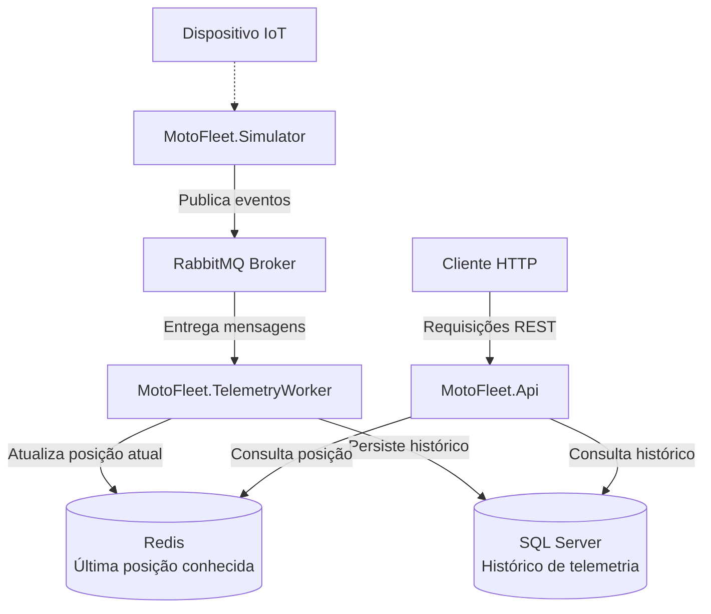

# 🛵 MotoFleet Core

**Plataforma distribuída de telemetria para frotas de motocicletas, desenvolvida com C# e .NET 10.**

O **MotoFleet Core** é um projeto de backend focado no processamento de telemetria IoT, utilizando mensageria assíncrona, processamento em background, cache distribuído e persistência relacional.

A solução foi estruturada para demonstrar conceitos de Clean Architecture, Event-Driven Architecture, escalabilidade, resiliência e testes automatizados em aplicações .NET.

---

## 📑 Sumário

- [Visão Geral](#-visão-geral)
- [Arquitetura do Sistema](#️-arquitetura-do-sistema)
- [Fluxo de Telemetria](#-fluxo-de-telemetria)
- [Tecnologias Utilizadas](#-tecnologias-utilizadas)
- [Estrutura da Solução](#-estrutura-da-solução)
- [Pré-requisitos](#-pré-requisitos)
- [Configuração do Ambiente](#️-configuração-do-ambiente)
- [Como Executar](#️-como-executar)
- [Frontend](#-frontend)
- [Testes Automatizados](#-testes-automatizados)
- [Endpoints da API](#-endpoints-da-api)
- [Confiabilidade e Resiliência](#-confiabilidade-e-resiliência)
- [Princípios de Arquitetura](#-princípios-de-arquitetura)
- [Roadmap](#️-roadmap)
- [Solução de Problemas](#-solução-de-problemas)
- [Contribuição](#-contribuição)
- [Licença](#-licença)

---

## 🎯 Visão Geral

O MotoFleet Core simula um ecossistema de telemetria IoT para monitoramento de frotas de motocicletas.

O sistema recebe eventos de telemetria, processa mensagens de forma assíncrona, mantém a última localização conhecida em cache e armazena o histórico em um banco de dados relacional.

### Principais objetivos

- Desacoplar produtores e consumidores por meio de mensageria.
- Processar eventos de telemetria em background.
- Disponibilizar a última localização conhecida com baixa latência.
- Armazenar o histórico de telemetria para consultas futuras.
- Separar regras de negócio, casos de uso e infraestrutura.
- Facilitar manutenção, testes e evolução dos componentes.
- Automatizar a infraestrutura local utilizando Docker Compose.

---

## 🏗️ Arquitetura do Sistema

O MotoFleet utiliza uma arquitetura orientada a eventos (*Event-Driven Architecture*), separando a publicação, o processamento e a consulta dos dados de telemetria.



## 🖥️ Frontend

O painel web usa React, Vite, Tailwind CSS e componentes shadcn/ui. Requer Node.js e npm.

Para desenvolvimento, inicie a API em `http://localhost:5240` e execute:

```powershell
cd src/MotoFleet.Web
npm install
npm run dev
```

Para servir o frontend pelo host ASP.NET, gere os arquivos estáticos antes de iniciar o projeto:

```powershell
cd src/MotoFleet.Web
npm install
npm run build
dotnet run
```

O host encaminha `/api/*` para `http://localhost:5240`. Configure `ApiBaseUrl` para apontar a outro endereço da API.